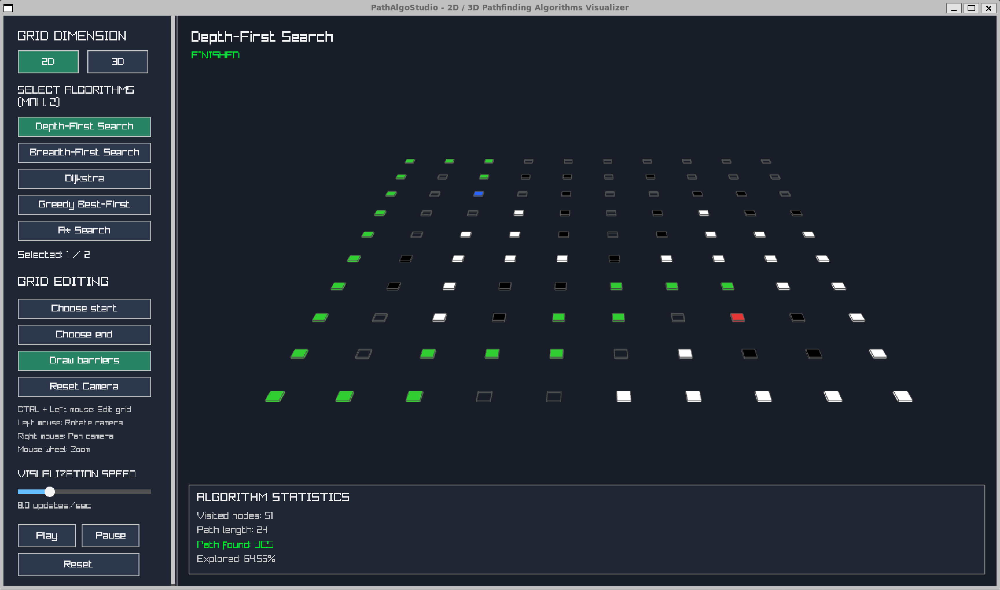
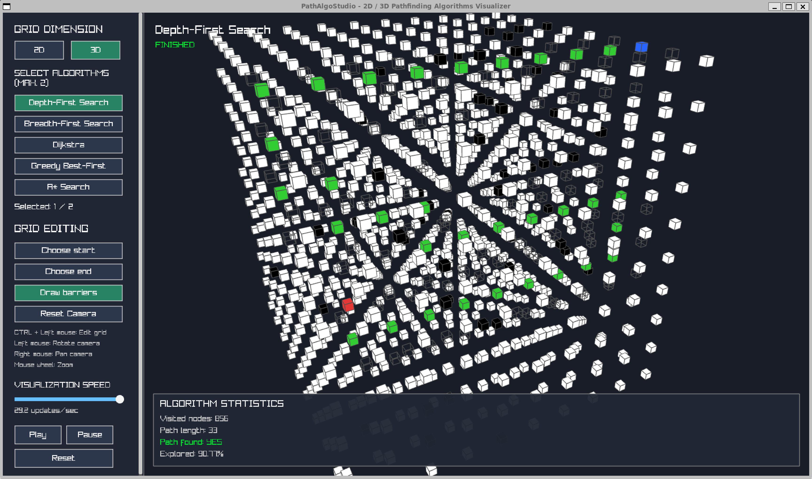
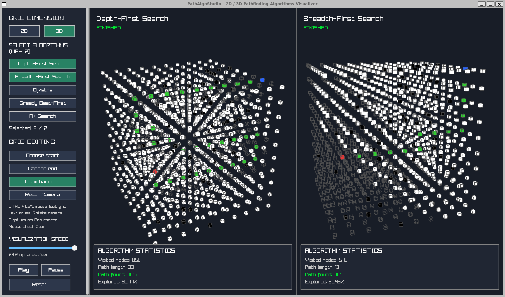

# PathAlgoStudio

**An interactive 2D and 3D pathfinding algorithm visualizer built with C++ and CMake.**





PathAlgoStudio is an interactive application designed to visualize, explore, and compare different pathfinding algorithms in both two-dimensional and three-dimensional grid environments.

The application provides real-time visualization of algorithm exploration, solution paths, and performance statistics. Users can configure grids, place obstacles, select start and end points, and compare two algorithms side by side.

---

## Features

- **2D and 3D visualization:** Explore pathfinding algorithms in both two-dimensional and three-dimensional grid environments.
- **Five pathfinding algorithms:** Choose between DFS, BFS, Dijkstra, Greedy Best-First Search, and A*.
- **Side-by-side comparison:** Run and compare two algorithms simultaneously on the same grid.
- **Interactive grid editing:** Select start and end positions and create or remove barriers.
- **Real-time visualization:** Watch how algorithms explore the grid and discover their solution paths.
- **Adjustable animation speed:** Control the visualization speed using an interactive slider.
- **3D camera controls:** Rotate, pan, and zoom around the grid.
- **Performance statistics:** Compare visited nodes, path length, path existence, and explored percentage.

---

## Supported Algorithms

PathAlgoStudio currently implements five pathfinding algorithms.

| Algorithm | Description |
|---|---|
| Depth-First Search (DFS) | Explores one branch as deeply as possible before backtracking. |
| Breadth-First Search (BFS) | Explores neighboring nodes level by level. |
| Dijkstra's Algorithm | Finds a shortest path using accumulated movement costs. |
| Greedy Best-First Search | Prioritizes nodes based on their heuristic distance to the goal. |
| A* Search | Combines accumulated movement cost and heuristic distance to find an optimal path under suitable conditions. |

The algorithms use graph-search approaches and operate on the same grid environment.

### Performance Comparison

After execution, the application displays the following statistics:

- **Visited Nodes:** Number of explored nodes.
- **Path Length:** Number of edges in the resulting path.
- **Path Found:** Indicates whether a solution was found.
- **Explored Percentage:** Percentage of traversable grid cells explored by the algorithm.

These statistics allow users to compare the search behavior and efficiency of different algorithms.

---

## Technologies Used

- **C++17** – Core application and pathfinding implementations.
- **Raylib** – Graphics rendering, visualization, and user interaction.
- **CMake** – Build system and project configuration.

---

## Project Structure

```text
PathAlgoStudio/
│
├── CMakeLists.txt
├── README.md
│
├── docs/
│   └── images/
│       ├── 2d-visualization.png
│       ├── 3d-visualization.png
│       └── algorithm-comparison.png
│
├── include/
│   ├── AlgorithmStatistics.hpp
│   ├── AlgorithmVisualizer.hpp
│   ├── Cell.hpp
│   ├── ComparisonManager.hpp
│   ├── Coordinate.hpp
│   ├── Grid.hpp
│   ├── GridConfig.hpp
│   └── Pathfinding.hpp
│
├── src/
│   ├── AStarSearch.cpp
│   ├── AlgorithmVisualizer.cpp
│   ├── BreadthFirstSearch.cpp
│   ├── ComparisonManager.cpp
│   ├── DepthFirstSearch.cpp
│   ├── GreedyBestFirstSearch.cpp
│   ├── Grid.cpp
│   ├── Pathfinding.cpp
│   ├── UniformCostSearch.cpp
│   └── main.cpp
│
└── initial_python_version_DEPRECATED/
    ├── README.md
    ├── astar_graphsearch.py
    ├── breadth_first_graphsearch.py
    ├── depth_first_graphsearch.py
    ├── greedy_best_first_graphsearch.py
    ├── uniform_cost_graphsearch.py
    ├── pathFindingAlgorithmsVisualizer.py
    └── demo-images/
```

The current application is implemented in C++. The `initial_python_version_DEPRECATED` directory contains the original Python implementation, which is retained for reference.

---

## Requirements

Before building the project, make sure the following tools are installed:

- A C++17-compatible compiler.
- CMake 3.18 or newer.
- Raylib.

### Dependencies

The project uses Raylib through CMake's package configuration:

```cmake
find_package(raylib CONFIG REQUIRED)
```

Make sure Raylib is installed and available to CMake before configuring the project.

---

## Installation and Build Instructions

### 1. Clone the Repository

```bash
git clone https://github.com/mrk-drn/PathAlgoStudio.git
```

Navigate into the project directory:

```bash
cd PathAlgoStudio
```

### 2. Configure the Project

Create a build directory:

```bash
cmake -S . -B build
```

CMake will configure the project and locate the Raylib dependency.

If Raylib is installed in a custom location, you may need to specify its CMake package directory:

```bash
cmake -S . -B build -Draylib_DIR=/path/to/raylib/lib/cmake/raylib
```

### 3. Build the Application

```bash
cmake --build build --config Release
```

This compiles the source files and generates the executable.

### 4. Run the Application

**Windows (Visual Studio multi-configuration generator):**

```bash
.\build\Release\PathAlgoStudio.exe
```

**Windows (single-configuration generator):**

```bash
.\build\PathAlgoStudio.exe
```

**Linux / macOS:**

```bash
./build/PathAlgoStudio
```

The exact executable location can depend on the operating system and CMake generator.

---

## How to Use

### 1. Configure the Grid

Choose between:

- **2D:** A two-dimensional grid.
- **3D:** A three-dimensional grid.

### 2. Select Algorithms

Select up to two algorithms from the algorithm selection menu.

Selecting two algorithms enables side-by-side comparison.

### 3. Edit the Grid

Use the editing controls to configure the environment:

- Choose Start: Select the starting position.
- Choose End: Select the destination.
- Draw Barriers: Add or remove obstacles.

### 4. Start the Visualization

Press **Play** to execute the selected algorithm or algorithms.

The application will visualize the exploration process and subsequently reveal the resulting solution path.

### 5. Analyze the Results

Once execution is complete, inspect the displayed statistics to compare the algorithms.

---

## Controls

| Input | Action |
|---|---|
| Left Mouse Button | Rotate the camera |
| Right Mouse Button | Pan the camera |
| Mouse Wheel | Zoom in and out |
| CTRL + Left Mouse Button | Edit the grid |
| Visualization Speed Slider | Adjust animation speed |
| Play | Start or resume visualization |
| Pause | Pause visualization |
| Reset | Reset the current visualization |
| Reset Camera | Restore the default camera position |

---

## Previous Python Implementation

The project originally started as a Python-based pathfinding visualizer.

The original implementation is retained in:

`initial_python_version_DEPRECATED/`

It includes implementations of the five pathfinding algorithms and the original visualization application.

The current and actively developed version is the C++ implementation.

---

## Future Improvements

Potential future improvements include:

- Additional pathfinding algorithms.
- More advanced performance metrics.
- Customizable grid dimensions.
- Different heuristic functions.
- Additional visualization options.
- Improved user interface and interaction.
- Exporting comparison results.

---


*PathAlgoStudio – Explore, visualize, and compare pathfinding algorithms in 2D and 3D.*
